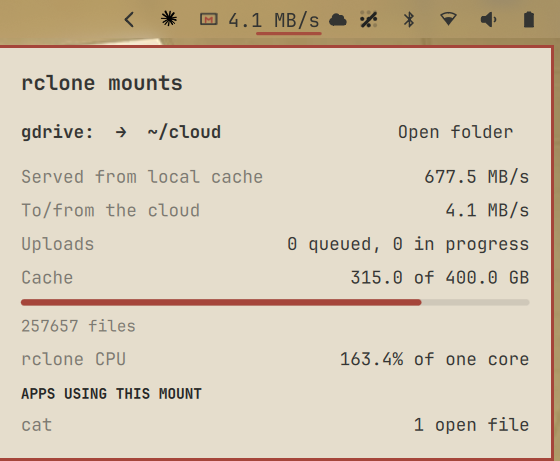

# rclone Cache Monitor

**Is rclone reading from your disk or from the cloud? Now you can see it, live in your bar.**

An Omarchy bar widget for the rclone mounts you already have. It shows what each one is doing right now:

- **Served from local cache vs. to/from the cloud.** Is rclone answering from its VFS cache on your disk, or moving data over the network?
- **Upload queue.** How many files are waiting to upload, and which ones.
- **Cache fill.** Size used against `--vfs-cache-max-size`, file count, and errored files.
- **Which apps are using each mount**, and rclone's own CPU use.



It's **read-only**. It never mounts, unmounts or changes anything. It sits alongside however you start rclone: a systemd unit, a script, `rclone mount --daemon`, or `rclone rcd`. If you want a plugin that *manages* remotes and mounts, see [omarchy-rclone](https://github.com/davidszp/omarchy-rclone).

## Install

```bash
omarchy plugin add https://github.com/verified-human-42/omarchy-rclone-cache-monitor --enable
```

That clones it into `~/.config/omarchy/plugins/`, validates it, and adds it to the right side of the bar. Move it with `omarchy bar move io.github.verified-human-42.rclone-cache-monitor --section <section>`.

## Turn on rclone's stats API (recommended)

Without it the widget can still tell you a mount is up, how fast rclone is reading, and its CPU use. To get the cache and upload numbers, add these flags to your `rclone mount` command:

```bash
--rc --rc-no-auth --rc-addr unix://$XDG_RUNTIME_DIR/rclone-<name>.sock
```

A unix socket in `$XDG_RUNTIME_DIR` can only be reached by your own user, so `--rc-no-auth` is safe there. A TCP address such as `--rc-addr localhost:5572` works too. `rclone rcd` mounts are picked up through their API automatically.

In a systemd user unit, use `%t` for the runtime dir: `--rc-addr unix://%t/rclone-gdrive.sock`.

## Using it

- **Bar icon:** a cloud.
  - While data is moving, it shows the network speed, or `↑N` while files wait to upload.
  - It turns red when a mount needs attention: a stale mount with no rclone process, an API that isn't answering, errored cache files, or a full cache.
- **Click** for the panel, which lists every mount. Each has an **Open folder** button.
- **Settings** (`omarchy bar set io.github.verified-human-42.rclone-cache-monitor <key> <value>`):
  - `pollSec` is how often it updates, 1–30 seconds (default 3).
  - `showRate` shows the speed in the bar, `true` or `false` (default true).

"Served from local cache" is everything rclone reads, minus what it transferred over the network. Reads from rclone's cache files count whether they come from the SSD or the page cache. Heavy writing into a mount inflates it a little.

## Requirements

Omarchy 4.x, rclone, plus `bash`, `jq`, `curl` and `findmnt`, which Omarchy already ships.

## How it works

`rclone-cache-stats` is a small bash script that prints one JSON snapshot:

1. It finds every mount with `findmnt -t fuse.rclone`.
2. It matches each mount to the rclone process serving it, from the process's command line or the `rcd` mount list.
3. It reads that process's `/proc/<pid>/io` and `/proc/<pid>/stat`.
4. Where the API is on, it calls `vfs/stats`, `vfs/queue` and `core/stats` with `curl`.

The widget runs the script every few seconds and turns the difference between snapshots into speeds. The list of apps using each mount is gathered only while the panel is open.

Nothing leaves your machine: it only talks to rclone's local API. File, mount and app names are shown as plain text and shortened when long.

## Remove

```bash
omarchy plugin remove io.github.verified-human-42.rclone-cache-monitor
```

Nothing else to clean up. The plugin stores no state, and your rclone setup is untouched.

## Tests

```bash
bash test/run.sh
```

The tests check the manifest, the translation keys, and that every text element is plain text. They also check the collector's output. If rclone and FUSE are available, they mount a temporary folder whose mount point and queued file have markup-like names, and check both come through verbatim.

## License

MIT
